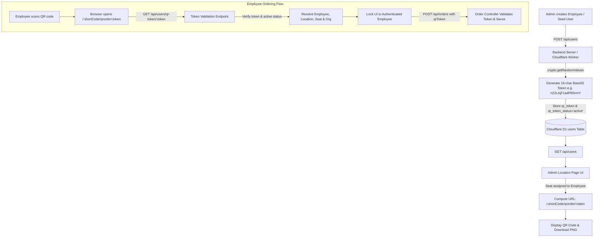

# Cafe4x — Unique QR Token Architecture & Implementation Plan

## 1. Problem Statement & Context

### 1.1 The Legacy Issue
Previously, Cafe4x used static, seat-based URLs:
```text
https://cafe4x.pages.dev/FTS/order/1792313156378/1?seatId=FTS-01
```
- **Security Vulnerability:** Anyone could tamper with the `seatId` parameter in the query string and impersonate another seat or employee.
- **Repeat Scans / State Desync:** If an admin assigned an employee to a seat in the Location page, clicking between different seat cards or changing locations could leave stale URLs or generate new temporary IDs on the fly in `localStorage`, causing inconsistency.

### 1.2 The Goal
Provide a **cryptographically secure, immutable, unique ordering URL and QR code for each employee**:
```text
https://cafe4x.pages.dev/FTS/qrorder/nZ2LAjF1adPBSrmY
```
Where `:token` is a 16-character Base62 random alphanumeric token (`crypto.getRandomValues`) tied to the employee record in the database.

---

## 2. URL Format Comparison & Section Resolution

| URL Format | Example | Behavior / Resolution |
|---|---|---|
| **Old Seat-Based URL** | `https://preview.cafe4x.com/FTS/qr/736/16` or `.../order/736/16?seatId=...` | **Legacy & Insecure**: Exposes location ID `736` and seat number `16` directly in the URL. Anyone changing `16` to `17` can place orders on another seat without authentication. |
| **New Employee QR URL** | `https://preview.cafe4x.com/FTS/qrorder/nZ2LAjF1adPBSrmY` | **Secure & Tamper-Proof**: Uses a 16-character cryptographically random token (`nZ2LAjF1adPBSrmY`). When opened, backend validates token, automatically resolves employee, location, and assigned seat, and locks the order to the verified employee. |

---

## 3. Token Generation & Storage Architecture



### 3.1 Database Schema (Cloudflare D1)

```sql
-- users table columns
ALTER TABLE users ADD COLUMN qr_token TEXT;
ALTER TABLE users ADD COLUMN qr_token_created_at TEXT;
ALTER TABLE users ADD COLUMN qr_token_status TEXT DEFAULT 'active'; -- 'active' | 'revoked'
CREATE UNIQUE INDEX IF NOT EXISTS idx_users_qr_token ON users(qr_token);

-- orders table columns
ALTER TABLE orders ADD COLUMN employee_id TEXT;
ALTER TABLE orders ADD COLUMN qr_token TEXT;
CREATE INDEX IF NOT EXISTS idx_orders_employee ON orders(employee_id);
CREATE INDEX IF NOT EXISTS idx_orders_qr_token ON orders(qr_token);
```

### 3.2 Token Generator (`id-generator.ts`)

```typescript
export function generateSecureQrToken(length: number = 16): string {
  const chars = "ABCDEFGHIJKLMNOPQRSTUVWXYZabcdefghijklmnopqrstuvwxyz0123456789";
  const bytes = new Uint8Array(length);
  crypto.getRandomValues(bytes);
  let result = "";
  for (let i = 0; i < length; i++) {
    result += chars[bytes[i] % chars.length];
  }
  return result; // e.g. "nZ2LAjF1adPBSrmY"
}
```


---

## 3. Resolving the Dynamic Drawer URL Issue

In the Location page, when an admin clicks on different seats:
1. **Unassigned Seat:**
   - URL: `https://cafe4x.pages.dev/:shortCode/order/:locId/:seatNumber?seatId=:seatId`
   - QR: Temporary guest QR code for that seat.
2. **Assigned Seat (to an employee):**
   - The drawer looks up the employee in `orgUsers` (fetched from `GET /api/users`).
   - If the employee has `qrToken`, the URL **dynamically and reliably** resolves to:
     `https://cafe4x.pages.dev/:shortCode/qrorder/:qrToken`
   - **Crucial Fix:** The drawer computes `effectiveOrderUrl` in real time so clicking any seat card always shows that specific employee's unique QR code and token without stale state desync.

---

## 4. Lifecycle & Security Controls

| Action | API Endpoint | Behavior | Security Guarantee |
|---|---|---|---|
| **Scan QR** | `GET /api/users/qr-token/:token` | Public endpoint that validates the token | Returns `404` for unknown tokens; `403` for revoked tokens. Does not leak passwords or sensitive metadata. |
| **Place Order** | `POST /api/orders` (with `qrToken`) | Server verifies token, resolves employee and org | Client cannot forge `employeeName` or `employeeId` by tampering with request payloads. |
| **Regenerate Token** | `POST /api/users/:id/qr-token/regenerate` | Admin-only endpoint | Invalidates previous token immediately. A new 24-character token is assigned. Old QR printouts stop working. |
| **Revoke Token** | `POST /api/users/:id/qr-token/revoke` | Admin-only endpoint | Marks `qr_token_status = 'revoked'`. User cannot place orders until regenerated. |

---

## 5. Implementation Checklist

- [x] Cloudflare D1 migration added (`0010_add_employee_qr_tokens.sql`) and executed.
- [x] Cryptographic Base62 token generator added to `id-generator.ts`.
- [x] Backend routes and controller added (`validateQrToken`, `regenerateQrToken`, `revokeQrToken`).
- [x] Backend `POST /api/orders` updated to validate `qrToken` server-side and associate `employee_id`.
- [x] Cloudflare Worker deployed to production (`https://cafe4x-api.m-imthiyaz.workers.dev`).
- [x] Frontend routes configured in `App.tsx` (`/:shortCode/qrorder/:qrToken`).
- [x] `UserOrderPage` updated to validate token on load, show verified employee pill, and reject invalid/revoked tokens.
- [x] `LocationPage` drawer updated to display dynamic employee QR code, **Copy Link**, **Download QR (PNG)**, **Regenerate**, and **Revoke** controls.
